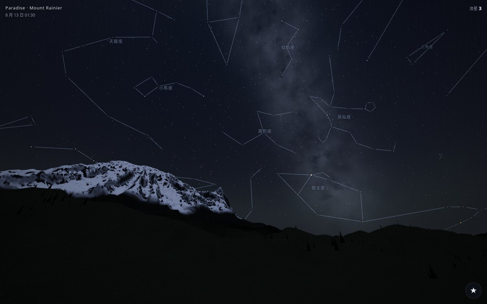
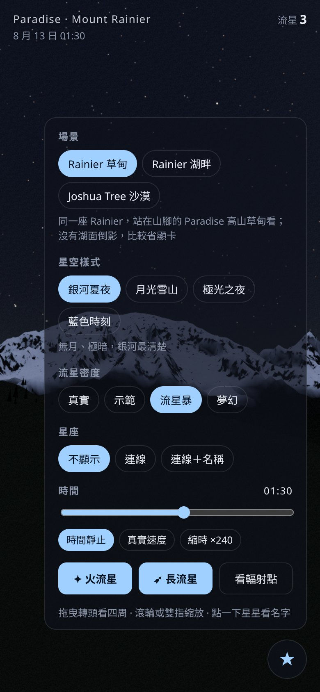

# meteor-night · 星空觀景台

**Live:** <https://paulpowang.github.io/meteor-night/> · **Source:** <https://github.com/paulpowang/meteor-night>



## English summary

A realistic night-sky viewer built with Vite, TypeScript, and three.js. Stand at Paradise below Mount Rainier and watch the Perseid meteor shower cross a real sky. You can also switch to Reflection Lakes (snowy peak, stars, and meteors mirrored in the water) or the Joshua Tree desert. Everything runs in the browser; settings are saved in `localStorage`.

**Highlights**

- **Meteor shower:** meteors radiate from the Perseid radiant with a realistic brightness distribution. Includes fireballs with green or orange glow and lingering trains, rare long "earth-grazers," and four densities: real, demo, storm, and dreamy (10–600 per minute).
- **Three scenes:** Rainier meadow (default), Rainier lake with reflections (heavier on the GPU), and Joshua Tree desert. The sky is computed for each site's latitude and longitude.
- **Real star map:** 5,044 stars to magnitude 6, positioned for the night of 2026-08-13, colored by B-V index, and dimmed and reddened near the horizon. A procedural Milky Way includes the Cygnus Rift.
- **Four sky styles:** Milky Way summer night, moonlit snow, aurora, and blue hour.
- **Constellations:** lines and Chinese names for all 88 constellations (off / lines / lines + names).
- **Tap to identify:** tap the sky to see a star's name, Bayer designation, constellation, magnitude, and position, with short notes for the brightest stars.
- **Controls:** drag to look around, scroll or pinch to zoom, jump to the radiant, scrub or time-lapse the clock.



**Quick start**

```bash
npm install
npm run dev     # http://127.0.0.1:5188
npm run build   # static output in dist/
```

**Deploy:** every push to `main` runs `.github/workflows/deploy.yml`, which builds `dist/` and publishes it to GitHub Pages (source: GitHub Actions). `base: './'` keeps all paths relative, so the site works under `/meteor-night/`.

URL parameters such as `?scene=`, `?preset=`, `?rate=`, and `?con=` are listed in the Chinese section below.

---

## 中文說明

站在 Mount Rainier 山腳的 Paradise 高山草甸，看英仙座流星雨劃過真實星空。也可以換到 Reflection Lakes 湖畔（湖面映出雪山、星星和流星），或 Joshua Tree 國家公園的沙漠。

## 快速開始

```bash
npm install
npm run dev        # http://127.0.0.1:5188
npm run build      # 輸出到 dist/，可放上任何靜態主機
```

### 部署到 GitHub Pages

`.github/workflows/deploy.yml` 會在推送到 `main` 時（repo：`paulpowang/meteor-night`）自動執行 `npm ci`、`npm run build`，再把 `dist/` 部署到 GitHub Pages。第一次使用前，要到 repo 的 **Settings → Pages**，把 **Source** 設成 **GitHub Actions**。`base: './'` 是相對路徑，放在 `https://<帳號>.github.io/<repo>/` 子路徑下也能正常載入。免費帳號的 repo 要設成公開，網站才能用 Pages 發佈。

網址參數（截圖驗證用）：`?scene=paradise|rainier|joshua`、`?preset=milkyway|moonlight|aurora|bluehour`、`?yaw=-4&pitch=8&fov=68`、`?con=off|lines|names`（星座）、`?star=91262`（直接選一顆星，數字是 HIP 編號）、`?rate=real|demo|storm|dreamy`、`?dream=300`（夢幻模式每分鐘顆數）、`?q=low`（強制低品質）、`?debug`（在 console 印出載入時間）。

## 功能

- **流星雨（主打）**：從英仙座輻射點往外放射；亮度依真實族群指數分布。流星走到終點後會先熄頭、尾巴再淡出，不會被瞬間截掉。
  - **火流星**：路徑較長、略為減速，帶綠光或橘光，末端爆亮，之後留下一道慢慢散開的餘跡。
  - **長流星**：約 4% 的流星（輻射點低時約 8%）是從遠離輻射點處貼著大氣層掠過的長流星，慢慢劃過 50°–110° 的天空。
  - 密度分成「真實」（約每分鐘 1 顆）、「示範」、「流星暴」、「夢幻」四種，也能手動放「火流星」「長流星」。
  - **夢幻**：一直有很多彩色流星，數量用滑桿調（每分鐘 10–600 顆，預設 120）；比較慢、比較亮，長流星和餘跡更多，三成流星來自隨機方向，不受輻射點高度影響。
- **3 個場景**（設定面板最上方切換，第一次切換約 0.4 秒，之後立即）：
  - **Rainier 草甸**（預設）：Paradise（46.79°N，海拔 1,645 m），山頂在北偏西 14°、7.7 km 外，仰角約 20°；前景是高山草甸和零星的矮冷杉。沒有湖面倒影，第一次打開不會吃重顯卡。
  - **Rainier 湖畔**：Reflection Lakes（46.77°N），雪山、冷杉、湖面倒影。比較吃顯卡（每幀多畫一次倒影），夢幻模式流星很多時更明顯，介面上有提示。
  - **Joshua Tree 沙漠**：Jumbo Rocks 附近的 Queen Valley（33.99°N），約書亞樹、花崗岩巨石堆、低矮灌木，遠方一圈低山，地平線開闊；西南方有 Coachella Valley 的光害。沒有湖面倒影，每幀少畫一次整個場景，比較省顯卡（三角形數約少 3 成）。
  - 星空依各場景的經緯度計算：在 Joshua Tree，北極星仰角約 34°，銀河中心比較高。
- **真實星空**：5,044 顆真實恆星（星等 6 以內），依 2026-08-13 凌晨的時間和觀測點位置計算；星色依 B-V 色指數，接近地平線時會變暗、變紅。另外補了 26,000 顆程式產生的暗星，讓銀河更有層次。
- **銀河**：沿真實銀道面分布，有雲氣和暗帶（天鵝座大裂縫）。
- **4 種星空樣式**：銀河夏夜、月光雪山、極光之夜、藍色時刻。
- **Rainier 與湖面倒影**：程式產生的山形（主峰、Little Tahoma、冷杉林），湖面會反射整個場景，可以調整風力，從無風如鏡到微風波紋。
- **星座（v2）**：88 星座的連線與中文名稱，設定面板可切換「不顯示／連線／連線＋名稱」，預設不顯示。連線又細又淡，跟星星共用同一個天球矩陣，不會出現在湖面倒影裡。
- **點星星認星（v2）**：點一下天空，找出最近的亮星（星等 ≤ 4.5 優先，只找看得到、沒被山擋住的星），顯示名稱、拜耳名、星座、星等、目前方位；全天最亮的 20 顆星和北極星附有簡介。拖曳超過約 6 px 就算轉頭，不算點擊。
- **操作**：拖曳轉頭、滾輪或雙指縮放，「看輻射點」一鍵轉向；時間可以拖動，也可以縮時播放；介面閒置 3 秒後自動淡出。
- 設定會存在 localStorage（`starshowing_settings_v1`；這是改名前的舊名，為了保留使用者已存的設定而不改）。

## 專案結構

```
index.html               畫面骨架與設定面板
src/main.ts              建場景、主迴圈、套用星空樣式
src/astro.ts             天文計算：恆星時、赤道→地平→世界座標、B-V→RGB、可重現亂數
src/presets.ts           4 種星空樣式的參數
src/scenes.ts            場景（地點）：經緯度、預設視角、光害方向、有沒有湖
src/sky/stars.ts         恆星點精靈 shader（星等、消光、閃爍）
src/sky/skydome.ts       天空穹頂：底色、氣輝、光害、銀河、月亮、極光、晨光
src/sky/meteors.ts       流星生成與繪製
src/sky/constellations.ts 星座連線（赤道座標的 LineSegments）
src/sky/identify.ts      點擊方向 → 最可能的星、組出認星資料
src/sky/lore.ts          88 星座中文名、亮星俗名與簡介
src/world/heightfield.ts 地形高度函式（Rainier、丘陵、Tatoosh、湖盆）
src/world/terrain.ts     極座標地形網格、雪線上色與雪面細節 shader
src/world/trees.ts       冷杉 InstancedMesh
src/world/lake.ts        Reflector 湖面倒影、波紋
src/world/horizon.ts     地景剪影仰角表（判斷星星是否躲在山後，各場景分開快取）
src/world/paradise.ts    Paradise 場景：沿用 Rainier 高度場、平移觀測點，草甸上色與冷杉設定
src/world/joshua.ts      Joshua Tree 場景：沙漠高度場、約書亞樹、花崗岩巨石、灌木
src/post.ts              光暈、ACES、暗角、顆粒
src/controls.ts          原地轉頭視角、點擊判定（移動 < 6 px 才算點擊）
src/ui.ts                設定面板、localStorage
src/overlay.ts           HTML 疊層：星座名稱、選取圈、認星卡
scripts/build-stars.mjs  data-src/ 星表、星名（簡轉繁）、星座連線 → public/data/stars.json
docs/art-brief.md        美術方向（已核准）
```

## 技術重點

- 天球轉換用 `eqToWorldMatrix`，把 3 個基底方向各轉一次就組成矩陣，星星整組只需要套一個矩陣。
- 星星、流星都在天球半徑 40 km 附近，湖面 Reflector 會一起反射，倒影裡也看得到。
- 全部程式產生，沒有圖片素材；唯一的資料檔是星表（含星名與星座連線，約 280 KB，gzip 後約 100 KB）。
- 星座名稱和認星卡用 HTML 疊層，每幀把方向投影到畫面上；Reflector 畫倒影前會先把星座連線藏起來。
- 效能：RTX 5060 筆電約 240 fps（1248×1273）；手機自動用低品質網格。

## 資料來源與授權

- 星表、星名、星座連線：[d3-celestial](https://github.com/ofrohn/d3-celestial)（BSD-3-Clause，Olaf Frohn），原始資料來自 HYG Database。授權全文見 `data-src/LICENSE-d3-celestial.txt`。星名的 `zh` 原本是簡體，建置時用 `build-stars.mjs` 裡的對照表轉成繁體。
- 星座中文名、亮星簡介：自行整理撰寫（`src/sky/lore.ts`）。

## 已知限制與待改進（Roadmap）

- 「月光雪山」是假設情境：2026-08-12 是新月，真實的英仙座極大夜沒有月亮。月亮位置是固定的，沒有依時間計算。
- 山形是程式擬合的近似形狀，不是真實地形資料。之後可以改用 USGS 3DEP 公有領域地形資料。
- 第一次載入要在主執行緒建地形（約 0.5 秒）；手機上可能更久，之後可以移到 Web Worker。
- 湖面倒影裡的星點會比實際稍大，因為反射貼圖的解析度較低。
- 認星卡還沒有距離資料（d3-celestial 星表沒有視差）；簡介目前只有最亮的 20 顆星和北極星，其他星只顯示基本資料。
- 星座名稱標籤放在連線頂點的平均位置，少數形狀細長的星座（例如長蛇座）標籤會偏離連線。
- 判斷「躲在山後」只算地形，沒有算前景的冷杉；樹後的星仍然點得到。
- 星座連線在藍色時刻也是同樣亮度，沒有隨天空亮度調整。
- 星空樣式的參數是照 Rainier 調的：在 Joshua Tree，「月光雪山」的說明仍寫雪山；「極光之夜」在 34°N 只有極強磁暴（例如 2024 年 5 月）才看得到。
- Joshua Tree 的山形與岩丘位置是依地圖概略擺放的程式地形，不是真實地形資料。
- 夢幻模式是藝術效果（多彩、隨機方向），不是真實天象；物件池上限 200 顆，滑桿拉到最大時偶爾會少畫幾顆。
